<h3><code>sariya@github ~ $ whoami</code></h3>

<picture>
  <source media="(prefers-color-scheme: dark)" srcset="./assets/hero-dark.svg" />
  
</picture>

**BI Engineer** with nearly five years across healthcare, energy and utilities, consulting and research. 
I find the signal in messy operational data, then build the pipelines, models and dashboards that keep it there.

 

<h3><code>sariya@github ~ $ ./results.sh</code></h3>

<picture>
  <source media="(prefers-color-scheme: dark)" srcset="./assets/results-dark.svg" />
  
</picture>

 
 

<h3><code>sariya@github ~ $ ./contributions.sh</code></h3>

<picture>
  <source media="(prefers-color-scheme: dark)" srcset="./assets/contributions-dark.svg" />
  
</picture>

 
 

<h3><code>sariya@github ~ $ ./career.sh</code></h3>

<picture>
  <source media="(prefers-color-scheme: dark)" srcset="./assets/career-dark.svg" />
  
</picture>

 
 

<h3><code>sariya@github ~ $ ./stack.sh</code></h3>

 

<h3><code>sariya@github ~ $ cat work.md</code></h3>

| Work | What it is | Result |
|------|------------|--------|
| **Fleet Forecaster** PSEG · Technical Intern · 2025–26 | A full-stack 10-year planning app for fleet replacement, demand and capacity, utilization, lifecycle, EV transition, cost and budget scenarios. It replaced an Excel-heavy process for 10–15 planners working with about 6,000 planning records. | **6 h → 5 min** processing **~$120K** saved a year **~80%** less planning effort |
| **Voice of Patient Business Review** Natera · BI Analyst · 2026 | Executive appendix reporting across patient-coordinator, billing and live-chat channels, built and validated in Snowflake and Power BI. CSAT/NPS, sentiment and queue-level metrics map back to their source systems. | An executive-ready view of patient experience, with every metric traced to its source |
| **AI Disposition Dashboard** Natera · BI Analyst · 2026 | Validated views of AI-generated call and contact dispositions, with L1/L2/L3 drilldowns by business unit, team and disposition. | Data-quality views and reconciliation checks that make AI-generated classifications usable in day-to-day operations |
| **PC Performance Scoreboard** Natera · BI Analyst · 2026 | Ranking logic for patient-coordinator performance across conversion, efficiency and rejected, missed, inbound and outbound calls. | Methodology changes isolated so unstable metrics never distort the overall ranking |
| **Commuter Use & Stipend Analytics Platform** PSEG · 2025–present | Dashboards, forms, approvals, archival logic and exception tracking for commuter-use and stipend operations, now being modernized for the 2027 program year. | Approval and status visibility in one place, with less dependence on manual Excel reporting |
| **AI Fleet Intelligence** PSEG · Technical Intern · 2026 | Secure, on-premises AI prototypes for fleet knowledge retrieval, summarization and decision support, using retrieval-augmented generation over a knowledge graph. | **$50K–$100K** estimated vendor cost avoided a year |
| **Client BI & data engineering** ASH‑TECH Solutions · 2023–24 | Client-facing BI, analytics and data-engineering engagements across Sales, Marketing, Finance, Product and Operations, with pipelines on Snowflake, BigQuery, Databricks and PostgreSQL. | **$200K+** in client value |
| **Reusable delivery playbooks** WebScape · 2021–23 | Client-facing BI and data delivery from discovery to go-live: requirements workshops, source-to-target mappings, pipelines, dashboards and UAT. | **30%** faster client onboarding |

<b>Behind Fleet Forecaster</b> (click to expand)

 

**The problem.** Fleet planning at PSEG ran on an Excel-heavy process. A full planning run took about 6 hours, for 10–15 planners working with about 6,000 planning records.

**What I built.** Fleet Forecaster, a full-stack app for 10-year planning across fleet replacement, demand and capacity, utilization, lifecycle, EV transition, cost and budget scenarios.

**The result.** Processing dropped from about **6 hours to 5 minutes**, planning effort by about **80%** and reporting setup by about **40%**, worth about **$120K** a year in savings.

**Stack:** React · TypeScript · Python · FastAPI · PostgreSQL · Redis · Excel/VBA · Power BI

 

<h3><code>sariya@github ~ $ ls ~/research</code></h3>

- **[GRAFT: gRPC-Routed Agent Framework for Tasking in Edge and Personal Devices](https://doi.org/10.1145/3786335.3813216)** ACM · CAIS ’26 · 2026
- **[Branch-Commit-Validate: A Git-Inspired Workflow for Autonomous Red-Team Agents](https://doi.org/10.1007/978-3-032-22208-4_37)** Springer Nature · SAM 2025 · 2025
- **[An Advanced AI-Driven Database System](https://doi.org/10.21125/edulearn.2025.1294)** IATED · EDULEARN25 · 2025
- **[Balancing Ethics and Crisis: Patterns for Media Companies](https://doi.org/10.64346/PLoP2025p20)** The Hillside Group · PLoP 2025 · 2025
- **Evaluation of Online Patterns for Course Design** EuroPLoP 2026 · forthcoming

 

<h3><code>sariya@github ~ $ ls ~/projects</code></h3>

**Data and ML engineering**

- [hierforecast](https://github.com/sariyarizwan/hierforecast): energy demand forecasts reconciled across a hierarchy (MinT shrinkage), so regional forecasts sum to national, scored on pinball loss.
- [dagcache](https://github.com/sariyarizwan/dagcache): a content-addressed, parallel pipeline runner for reproducible ML workflows, with staleness explanations and artifact lineage.
- [modelcanary](https://github.com/sariyarizwan/modelcanary): progressive delivery for ML models, a FastAPI gateway that serves ONNX models in shadow, then canary, with sequential tests deciding promotion or rollback.
- [replayagent](https://github.com/sariyarizwan/replayagent): a single-node durable execution runtime for LLM agents, using event-sourced SQLite history and deterministic replay to resume after crashes.
- [sariyarizwan.github.io](https://github.com/sariyarizwan/sariyarizwan.github.io): the source of [sariyarizwan.com](https://sariyarizwan.com), with three small data games and a SQL console over the résumé.

**Security tooling**

- [sigmaforge](https://github.com/sariyarizwan/sigmaforge): a Sigma detection-rule compiler that renders Splunk SPL, Elastic EQL, Microsoft KQL and SQLite SQL, checked by property-based differential tests.
- [evtxkit](https://github.com/sariyarizwan/evtxkit): a from-scratch Rust parser for Windows EVTX event logs, with a chunk-parallel JSONL pipeline and damaged-file recovery.
- [tamperlog](https://github.com/sariyarizwan/tamperlog): a tamper-evident audit log with Merkle checkpoints and externally anchored roots.
- [yaraci](https://github.com/sariyarizwan/yaraci): a CI harness for YARA rule quality that lints rules, tests them on fixtures and scans goodware for false positives.
- [picklescope](https://github.com/sariyarizwan/picklescope): a static scanner for ML model files that inspects pickle, PyTorch, Keras, safetensors, GGUF and ONNX without deserializing them.
- [squatwatch](https://github.com/sariyarizwan/squatwatch): an offline detector for typosquats, dependency-confusion exposure and risky install hooks in npm and PyPI dependencies.

 

<h3><code>sariya@github ~ $ ./play.sh</code></h3>

<a href="https://sariyarizwan.com/#play">
<picture>
  <source media="(prefers-color-scheme: dark)" srcset="./assets/arcade-dark.svg" />
  
</picture>
</a>

My last 12 months of contributions, played as a level. Press start for three small data games on my site.

 
 

<h3><code>sariya@github ~ $ exit</code></h3>

I'm open to **BI Engineer, Analytics Engineer and Data Engineer** roles, in New York or remote. 
Email is the fastest way to reach me: [sariyarizwan25@gmail.com](mailto:sariyarizwan25@gmail.com)

The charts on this page are drawn by <a href="./scripts/build.mjs">scripts/build.mjs</a>, and a GitHub Action redraws them every day.

